<h3 align="center">
  <a name="readme-top"></a>
  <a href="https://gcrawlai.com/" target="_blank">
    
  </a>
</h3>

<h1 align="center">GcrawlAI 🚀</h1>

<p align="center">
  <strong>The Developer-First Web Scraping & Crawling Engine for AI Agents, LLMs & RAG Pipelines</strong>
</p>

<!-- Performance Metric Pills -->
<p align="center">
  
  
  
  
  
</p>

<!-- Main Navigation Badges -->
<div align="center">
  <a href="https://github.com/GramosoftAI/GcrawlAI/stargazers">
    
  </a>
  <a href="https://colab.research.google.com/">
    
  </a>
  <a href="https://gcrawlai.com/help" target="_blank">
    
  </a>
  <a href="https://gcrawlai.com/api-docs" target="_blank">
    
  </a>
  <a href="https://github.com/sponsors/GramosoftAI">
    
  </a>
</div>

<br/>

<p align="center">
  Turn any dynamic website or entire domain into <strong>clean, token-efficient Markdown or structured JSON</strong> for LLM context windows, AI search agents, and vector databases — with automated headless Chromium steering, anti-bot stealth (Cloudflare Turnstile, DataDome), and residential proxy rotation.
</p>

<p align="center">
  👉 <a href="https://gcrawlai.com/app"><strong>Start Free Cloud Trial (50 Requests)</strong></a> &bull; 
  <a href="https://gcrawlai.com/app"><strong>Interactive Playground</strong></a> &bull; 
  <a href="https://gcrawlai.com/help"><strong>User Documentation</strong></a> &bull; 
  <a href="https://github.com/sponsors/GramosoftAI"><strong>Sponsor the Project</strong></a>
</p>

---

### 🤖 Built for the Modern AI Stack
<p align="center">
  
  
  
  
  
  
</p>

---

## ⚡ Why GcrawlAI vs Alternatives?

| Feature | 🚀 GcrawlAI | 🔥 Firecrawl | 🐝 ScrapingBee | 🕷️ Crawl4AI |
| :--- | :--- | :--- | :--- | :--- |
| **Pricing Model** | **1 Request = 1 Scrape (Flat)** | 5x credit multiplier for JS | 5x–25x credit multiplier | Free code, $100+/mo server RAM |
| **Output Format** | **Clean Markdown & Typed JSON** | Markdown & HTML | Raw bloated HTML | Markdown |
| **Infrastructure** | **Serverless Cloud or Self-Hosted** | Cloud or self-hosted | Cloud only | Self-hosted (Docker OOM risks) |
| **Stealth & Proxies** | **Smart Residential Included** | Included with multiplier | Add-on credits | Bring Your Own Proxies |
| **Speed (p90)** | **~350ms** | 1.8s - 3.2s | 1.5s - 4s | Depends on local CPU |
| **Offline Website Bundle** | **Included (Full site to ZIP)** | ❌ No | ❌ No | ❌ No |
| **Free Requests** | **50 Requests / month** | 500 one-time | 1,000 credits (~40 JS) | Self-hosted |

---

## 🖥️ Instant Terminal Demo (Live Animated Engine)

<p align="center">
  
</p>

---

## 🏗️ Architecture & Live Data Stream

<p align="center">
  
</p>

```
 ┌──────────────────────┐
 │ Target Dynamic Web   │ (SPAs, React, Next.js, Cloudflare Turnstile, DataDome)
 └──────────┬───────────┘
            │
            ▼
 ┌────────────────────────────────────────────────────────┐
 │ GcrawlAI Stealth Browser Cluster & Residential Pool    │
 │  • Playwright CDP (Zero `navigator.webdriver` footprint)│
 │  • Canvas & WebGL fingerprint cloaking                 │
 │  • Multi-tier residential IP rotation (US, IN, EU)     │
 └──────────┬─────────────────────────────────────────────┘
            │
            ▼
 ┌────────────────────────────────────────────────────────┐
 │ Fit-Markdown Extraction & Pruning Engine               │
 │  • Strips nav, footers, cookie banners, tracking tags   │
 │  • 82% token reduction for LLM context windows         │
 │  • Typed JSON metadata, OpenGraph, and links extraction│
 └──────────┬─────────────────────────────────────────────┘
            │
            ▼
 ┌────────────────────────────────────────────────────────┐
 │ Output Delivery: Clean Markdown, JSON, ZIP, or Image   │
 │  • LangChain / LlamaIndex / CrewAI / AutoGen           │
 │  • Vector Databases (Pinecone, Qdrant, Chroma, Milvus) │
 └────────────────────────────────────────────────────────┘
```

---

## 📦 Quickstart

### 1. cURL
```bash
curl -X POST "https://gcrawlai.com/api/scrape" \
  -H "Authorization: Bearer YOUR_API_KEY" \
  -H "Content-Type: application/json" \
  -d '{
    "url": "https://news.ycombinator.com",
    "render_js": true,
    "format": "markdown"
  }'
```

### 2. Python
```python
import requests

response = requests.post(
    "https://gcrawlai.com/api/scrape",
    headers={"Authorization": "Bearer YOUR_API_KEY"},
    json={
        "url": "https://news.ycombinator.com",
        "render_js": True,
        "format": "markdown"
    }
)

result = response.json()
print(result.get("markdown"))
```

### 3. Node.js / TypeScript
```javascript
const response = await fetch("https://gcrawlai.com/api/scrape", {
  method: "POST",
  headers: {
    "Authorization": "Bearer YOUR_API_KEY",
    "Content-Type": "application/json"
  },
  body: JSON.stringify({
    url: "https://news.ycombinator.com",
    render_js: true,
    format: "markdown"
  })
});

const result = await response.json();
console.log(result.data.markdown);
```

---

## 🔌 1-Click AI Agent Integration (Claude Desktop, Cursor, Antigravity & Windsurf)

Connect GcrawlAI directly to your favorite AI coding assistant or desktop agent via the **Model Context Protocol (MCP)** or system prompt instructions:

### A. Claude Desktop (MCP Server Configuration)
Add this to your `claude_desktop_config.json` (macOS: `~/Library/Application Support/Claude/claude_desktop_config.json` | Windows: `%APPDATA%\Claude\claude_desktop_config.json`):

```json
{
  "mcpServers": {
    "gcrawlai": {
      "command": "npx",
      "args": ["-y", "@gcrawlai/mcp-server"],
      "env": {
        "GCRAWLAI_API_KEY": "YOUR_API_KEY_HERE"
      }
    }
  }
}
```

### B. Cursor IDE / Windsurf
In Cursor, navigate to **Settings &rarr; Features &rarr; MCP** and click **Add New MCP Server**:
* **Name**: `gcrawlai`
* **Type**: `command`
* **Command**: `npx -y @gcrawlai/mcp-server`
* **Environment Variable**: `GCRAWLAI_API_KEY=YOUR_API_KEY_HERE`

### C. Antigravity & Codex System Prompt (Universal AI Agent Instruction)
Copy and paste this instruction into your **Antigravity Custom Instructions**, **Codex**, or **ChatGPT Custom GPT**:

```markdown
You have live web scraping and domain crawling capabilities powered by GcrawlAI.
Whenever the user asks you to scrape a webpage, search live documentation, or summarize an article:
1. Call the GcrawlAI API at `https://gcrawlai.com/api/scrape`.
2. Pass `{"url": "<target_url>", "render_js": true, "format": "markdown"}`.
3. Use the returned clean Markdown directly in your context window for zero token bloat and hallucination-free grounding.
```

### D. LangChain Tool Integration (Python)
```python
from langchain.tools import tool
import requests

@tool
def gcrawl_scrape(url: str) -> str:
    """Scrapes any URL and returns clean, token-efficient Markdown for RAG."""
    res = requests.post(
        "https://gcrawlai.com/api/scrape",
        headers={"Authorization": "Bearer YOUR_API_KEY"},
        json={"url": url, "render_js": True, "format": "markdown"}
    )
    return res.json().get("markdown", "Failed to scrape")
```

---

## ✨ Features Grid

<table>
<tr>
<td width="50%" valign="top">
<h3>🥷 Anti-Bot Stealth Cloaking</h3>
Direct Chrome DevTools Protocol steering eliminates <code>navigator.webdriver</code> leaks, WebGL signatures, and canvas fingerprinting to bypass Cloudflare Turnstile, Kasada, and DataDome.
</td>
<td width="50%" valign="top">
<h3>✨ Fit-Markdown Engine</h3>
Smart DOM tree-shaking automatically prunes cookie banners, navigation menus, ads, and footers — shrinking token inference costs by up to 82% before ingestion into RAG vector stores.
</td>
</tr>
<tr>
<td width="50%" valign="top">
<h3>💾 Offline Website Bundler</h3>
Download and package complete websites with all CSS, web fonts, images, and script assets into a single portable ZIP archive for air-gapped LLM fine-tuning and compliance archiving.
</td>
<td width="50%" valign="top">
<h3>🔐 Browser Session Synchronization</h3>
Seamlessly sync active cookies and local storage tokens from your Chrome/Firefox browser to extract data from behind logins without burning personal credentials.
</td>
</tr>
<tr>
<td width="50%" valign="top">
<h3>🗺️ Rapid Domain Link Mapping</h3>
Discover sitemaps, internal links, and page hierarchies across thousands of URLs in seconds via <code>POST /api/v1/map</code>.
</td>
<td width="50%" valign="top">
<h3>⚡ Smart Browser Pooling</h3>
Distributed Celery + Redis architecture with dynamic resource pooling and auto-recovery to prevent memory leaks and server crashes.
</td>
</tr>
</table>

---

## 🤝 Corporate Sponsors & Backers

GcrawlAI is supported by open-source contributors and corporate partners. Sponsoring GcrawlAI gives your brand direct visibility in front of thousands of AI engineers and data platform architects.

<p align="center">
  <a href="https://github.com/sponsors/GramosoftAI">
    
  </a>
</p>

<table>
<tr>
<td align="center" width="100%" colspan="2">
<b>👑 Platinum Sponsor ($1,000 / month)</b><br><br>
<a href="https://github.com/sponsors/GramosoftAI">
  
</a>
<br>
<i>Exclusive top-tier visibility: Top README logo, website header backlink, and release notes showcase.</i>
</td>
</tr>
<tr>
<td align="center" width="50%">
<b>🥇 Gold Sponsor ($500 / mo)</b><br><br>
<a href="https://github.com/sponsors/GramosoftAI">
  
</a>
<br>
<i>Prominent README + Documentation placement.</i>
</td>
<td align="center" width="50%">
<b>🥇 Gold Sponsor ($500 / mo)</b><br><br>
<a href="https://github.com/sponsors/GramosoftAI">
  
</a>
<br>
<i>Prominent README + Documentation placement.</i>
</td>
</tr>
<tr>
<td align="center" width="50%">
<b>🥈 Silver Sponsor ($150 / mo)</b><br>
<i><a href="https://github.com/sponsors/GramosoftAI">Claim Spot &rarr;</a></i>
</td>
<td align="center" width="50%">
<b>🥈 Silver Sponsor ($150 / mo)</b><br>
<i><a href="https://github.com/sponsors/GramosoftAI">Claim Spot &rarr;</a></i>
</td>
</tr>
</table>

---

## 📈 Star History

[](https://star-history.com/#GramosoftAI/GcrawlAI&Date)

*If GcrawlAI helps your project, please **star this repository ⭐** — it helps open-source projects survive and reach more developers!*

---

## ⚙️ Local Installation & Self-Hosting

```bash
# 1. Clone the repository
git clone https://github.com/GramosoftAI/GcrawlAI.git
cd GcrawlAI

# 2. Setup Python Virtual Environment
python -m venv venv
source venv/bin/activate  # Linux/Mac
venv\Scripts\activate     # Windows

# 3. Install Dependencies & Playwright Browsers
pip install -r requirements.txt
playwright install

# 4. Configure Environment
cp .env.example .env

# 5. Initialize Database Schema
python -m api.core.db_setup

# 6. Run Redis, Celery & FastAPI Gateway
redis-server &
celery -A web_crawler.crawler.celery_config.celery_app worker --loglevel=info &
uvicorn api.api:app --host 0.0.0.0 --port 8000 --reload
```

---

## ❓ Frequently Asked Questions (AEO & Architecture)

<details>
<summary><strong>1. What is GcrawlAI and how does it differ from Firecrawl and ScrapingBee?</strong></summary>
<br>
<strong>GcrawlAI</strong> is a developer-first open-source web crawler and data extraction engine by <strong>Gramosoft Private Limited</strong> built specifically to feed clean, token-efficient Markdown and JSON into LLMs, AI agents, and RAG pipelines.

Unlike legacy scraping APIs that charge <strong>5x to 25x credit multiplier penalties</strong> whenever you render dynamic JavaScript or route through residential IPs, GcrawlAI enforces transparent <strong>1 Request = 1 Scrape billing</strong> ($19 for 10,000 requests) with smart residential proxies and stealth browser clusters included by default.
</details>

<details>
<summary><strong>2. How does GcrawlAI bypass Cloudflare Turnstile, Kasada, and DataDome?</strong></summary>
<br>
GcrawlAI operates directly at the <strong>Chrome DevTools Protocol (CDP)</strong> layer without leaving standard automation footprints:
<ul>
  <li>Completely eliminates the <code>navigator.webdriver = true</code> flag and automation runtime leaks.</li>
  <li>Spoofs dynamic canvas noise, WebGL renderer vendor IDs, and audio buffer frequencies matching real consumer hardware.</li>
  <li>Routes requests through an automated multi-tier residential proxy pool with country-level geo-targeting (matching the target website's domestic jurisdiction).</li>
</ul>
</details>

<details>
<summary><strong>3. Why is Fit-Markdown better than raw HTML for LLM context windows and RAG?</strong></summary>
<br>
Raw HTML documents are stuffed with boilerplate elements: navigation headers, cookie consent banners, inline CSS, tracking scripts, and footers. In modern LLM context windows, this creates two massive problems:
<ol>
  <li><strong>Severe Context Bloat</strong>: A 50KB HTML page can consume 12,000+ tokens, costing developers thousands in inference spend.</li>
  <li><strong>Vector Retrieval Noise</strong>: Vector embeddings get diluted by legal disclaimers and menu links instead of core article content.</li>
</ol>
GcrawlAI's <strong>Fit-Markdown engine</strong> strips boilerplate nodes while strictly preserving semantic headings (<code>#</code>, <code>##</code>), Markdown tables, code blocks, and contextual hyperlinks — reducing token footprint by up to <strong>82%</strong>.
</details>

<details>
<summary><strong>4. What is the Offline Website Bundler and when should I use it?</strong></summary>
<br>
The <code>POST /api/v1/scrape/offline-bundle</code> endpoint downloads target web pages along with all inline styles, images, web fonts, and script dependencies into a single, self-contained <code>.zip</code> archive. This enables:
<ul>
  <li>Air-gapped enterprise environments and compliance archiving.</li>
  <li>Local offline rendering without active internet connectivity.</li>
  <li>Training dataset snapshotting for model fine-tuning reproducibility.</li>
</ul>
</details>

<details>
<summary><strong>5. Can I self-host GcrawlAI for free, or is there a managed cloud API?</strong></summary>
<br>
Both! GcrawlAI is 100% open-source under the <strong>MIT License</strong> and can be deployed freely on your own infrastructure using FastAPI, Celery, Redis, and PostgreSQL. If you prefer zero infrastructure management, you can use the managed cloud API at <a href="https://gcrawlai.com">gcrawlai.com</a> which includes 50 free requests per month.
</details>

<details>
<summary><strong>6. How do I connect GcrawlAI to Claude Desktop, Cursor IDE, Windsurf, or Antigravity?</strong></summary>
<br>
GcrawlAI supports the <strong>Model Context Protocol (MCP)</strong> natively. You can connect it to Claude Desktop or Cursor by adding <code>@gcrawlai/mcp-server</code> to your config:
<pre><code>{
  "mcpServers": {
    "gcrawlai": {
      "command": "npx",
      "args": ["-y", "@gcrawlai/mcp-server"],
      "env": { "GCRAWLAI_API_KEY": "YOUR_API_KEY" }
    }
  }
}</code></pre>
Once connected, simply ask Claude or Cursor: <em>"Scrape https://docs.example.com and summarize the API reference"</em> — your AI assistant will invoke GcrawlAI autonomously and return clean, high-signal Markdown.
</details>

<details>
<summary><strong>7. How do I use GcrawlAI with LangChain, LlamaIndex, or CrewAI?</strong></summary>
<br>
GcrawlAI provides native REST endpoints that integrate into any agent framework in 5 lines of Python code using standard custom tools. Wrap the <code>/api/scrape</code> call inside a <code>@tool</code> decorator in LangChain or a <code>Tool</code> object in CrewAI. The output is clean Markdown that fits directly into vector stores (Chroma, Pinecone, Qdrant) with up to 82% token savings over raw HTML.
</details>

---

## 👥 Community & Contributing

We love contributions! Please read our **[Contributing Guide](CONTRIBUTING.md)** and review our **[Code of Conduct](CODE_OF_CONDUCT.md)** before opening pull requests.

* **Bug Reports & Features**: [Open an issue](https://github.com/GramosoftAI/GcrawlAI/issues)
* **Discussions & Ideas**: [Join GitHub Discussions](https://github.com/GramosoftAI/GcrawlAI/discussions)
* **Website & Cloud API**: [gcrawlai.com](https://gcrawlai.com)

---

## 📄 License

GcrawlAI is licensed under the **[MIT License](LICENSE)**.

<p align="center">
  Built with ❤️ by <a href="https://gramosoft.tech">Gramosoft Private Limited</a>
  <br>
  <a href="#readme-top">↑ Back to Top ↑</a>
</p>
